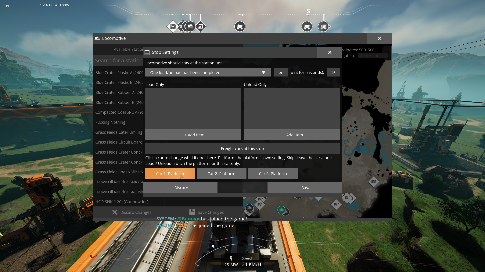
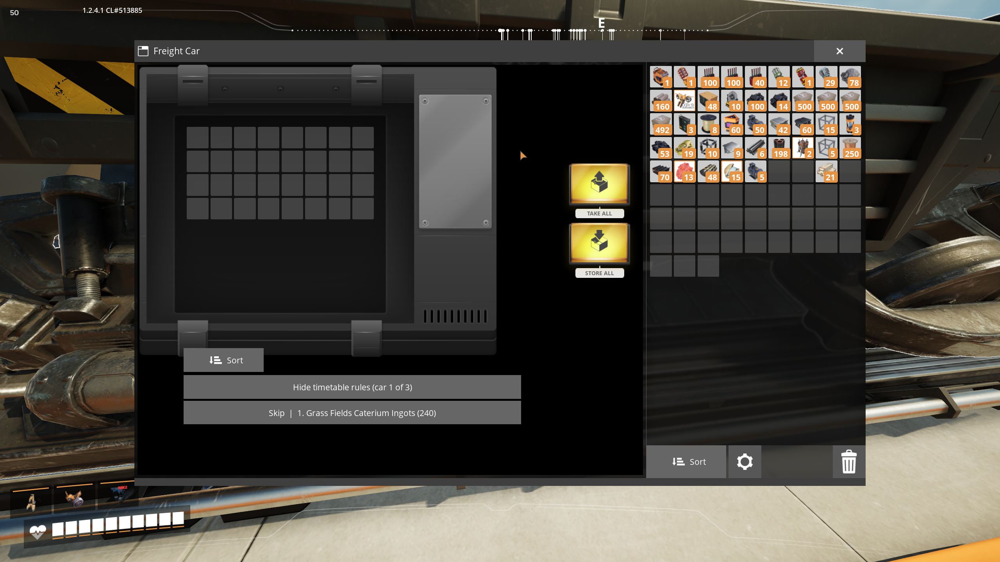

## Freight Car Control

In vanilla Satisfactory a freight platform loads or unloads whatever car stops beside it, for every train, and a
timetable's item filters apply to the whole train. So a train can't fill car 1 at one station, car 2 at another and
car 3 at a third when those stations have the same platforms.

Freight Car Control adds a rule per car, per timetable stop:

| Mode | What the car does at that stop |
|---|---|
| **Platform** (default) | Whatever the platform beside it is set to, as in vanilla. |
| **Skip** | Nothing. The platform leaves it alone and doesn't hold the train for it, even with "Fully load/unload". |
| **Load** | Gets loaded, even if the platform is set to unload. The platform switches back when the train leaves. |
| **Unload** | Gets unloaded, even if the platform is set to load. The platform switches back when the train leaves. |

Rules belong to the train, so other trains using the same stations aren't affected.

**Goes well with:** [SmartTrains](https://ficsit.app/mod/SmartTrains), which plans trips car by car and uses
Freight Car Control to skip cars at stops where they have no work, and [Auto Trains](https://ficsit.app/mod/AutoTrains),
which drives self-driving trains without signals. More under Works with below.

### Where to set rules

- **Timetable editor.** Open a locomotive, edit its timetable and open a stop's settings. Under the load and unload
  filters there's a **Freight cars at this stop** section with a button per car; each click cycles Platform → Skip →
  Load → Unload, and a right-click goes back. Save the stop, then save the timetable.
- **Freight car menu.** Open a freight car and click **Timetable rules** to see this car's mode at every stop of its
  train. Clicks save straight away.
- **From the map.** Train rows in the map's list get a timetable button that opens that train's locomotive menu
  without driving it, so you can edit its timetable and car rules from anywhere.

Car 1 is the freight car next to the locomotive, counting freight cars only; fluid cars are marked. With a
locomotive at each end (push-pull), cars count from the front locomotive: the one in control when the train got its
first car rule. Adding, removing or replacing freight cars keeps the numbering.

### Works with

- Vanilla train stations and freight and fluid platforms.
- **[SmartTrains](https://ficsit.app/mod/SmartTrains)** (beta) sends trains where items are needed without fixed
  timetables, and plans which car loads what where. With Freight Car Control it can stop a train at a station
  where only some of its cars have work: the other cars skip that stop, so cargo for later stops stays on board.
  Without it, far fewer of its trips work.
- **[Auto Trains](https://ficsit.app/mod/AutoTrains)** drives self-driving trains without block or path signals.
  Car rules work as usual.
- **[Modular Stations](https://ficsit.app/mod/ModularStations)**: freight, fluid and "ports below" platforms. Modular
  Stations isn't required.
- **[DynamicTimeTable](https://ficsit.app/mod/DynamicTimeTable)**: rules stay with their stop when it swaps a stop to
  another station of a group, also while the timetable editor is open.
- Reordering, adding and removing stops: rules follow their stops.
- Multiplayer and dedicated servers (Windows and Linux).

### Good to know

- **Load on an unload platform** loads whatever is in the platform's storage, which is the cargo earlier trains left
  there. Useful for passing cargo between trains.
- If you change a platform's setting yourself while a car is docked with Load or Unload, your setting is kept.
- Uninstalling the mod returns every train to vanilla behaviour. Rules are stored by the mod, not in the game's own
  save data. A platform switched by Load or Unload at the moment you uninstall stays switched; switch it back by hand.

### Bugs and ideas

Report them on [GitHub](https://github.com/benvrakas/FreightCarControl/issues). The source code is there too.
