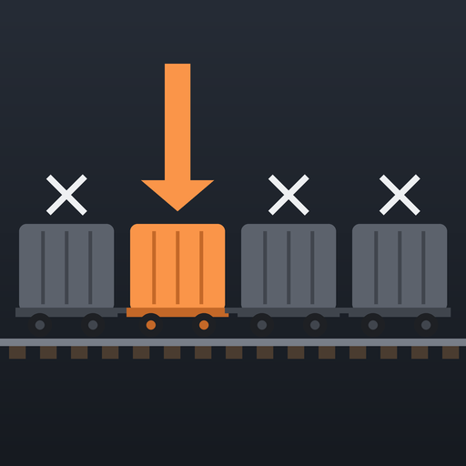

# Freight Car Control

A Satisfactory mod that lets a train's timetable say, for each stop, what each freight car does: use the platform's
setting, be skipped, or load or unload whatever the platform is set to. A train can fill car 1 at one station, car 2 at
another and so on, even when every station has the same platforms.

- Works with vanilla train stations and [Modular Stations](https://ficsit.app/mod/ModularStations).
- Rules belong to the train, so other trains using the same stations are unaffected.
- Skipped cars don't hold the train, even with "Fully load/unload".
- Load and Unload switch the platform for that car's dock only and put the platform's own setting back afterwards.
- Nothing is written into vanilla save data; removing the mod returns every train to vanilla behaviour.

Set rules in a locomotive's timetable editor (each stop's settings get a "Freight cars at this stop" section) or in a
freight car's menu. The `/fcc` chat command does the same, for testing.

- Mod page text and changelog: [Docs/Release](Docs/Release)
- How it works: [Docs/Architecture.md](Docs/Architecture.md)
- Logs, the `/fcc` command and a test checklist: [Docs/Debugging.md](Docs/Debugging.md)
- Icon: `python Tools/make_icon.py`
- Build: place the folder in the SML starter project's `Mods` folder and package it with Alpakit (Windows, Windows
  server and Linux server targets)
